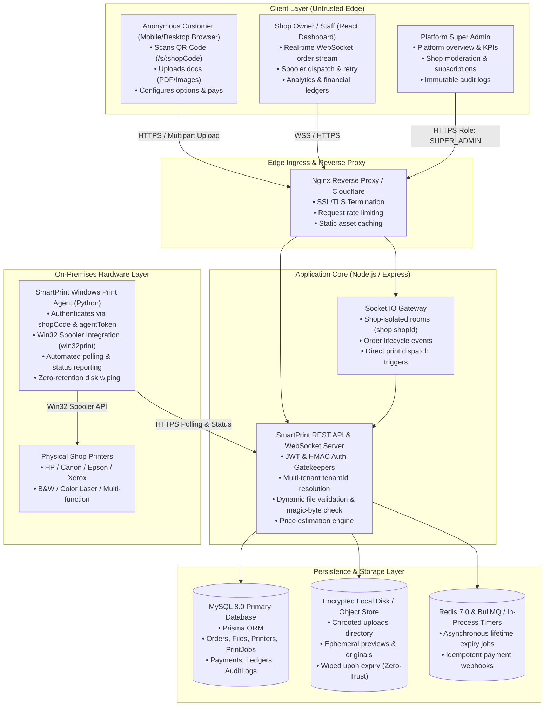

# SmartPrint System Architecture & Technical Design

## 1. Executive Summary
**SmartPrint** is a high-performance, multi-tenant cloud print management platform designed for commercial printing shops, university copy centers, and document kiosks. It eliminates customer friction through zero-registration QR code uploads while providing shop operators with real-time order dispatch, physical Windows direct printing automation, verifiable financial analytics, and multi-tenant security isolation.

---

## 2. Platform Architecture Diagram

---

## 3. Core Architectural Subsystems

### 3.1 Anonymous Customer Portal Subsystem
- **Zero-Registration Ingress:** Customers scan physical QR code (`/s/:shopCode`), creating a high-entropy ephemeral `CustomerSession` cookie without revealing phone, email, or personal identity.
- **Client-Side File Preprocessing:** Evaluates page counts using `pdf-lib`, calculates pricing via server-side rules, and enables client previewing.
- **Payment Abstraction:** Supports Razorpay online payments with HMAC-SHA256 signature verification or Cash/UPI counter collection.

### 3.2 Real-Time Order Management Subsystem
- **Bi-Directional WebSockets:** Powered by Socket.IO with multi-tenant room isolation (`shop:<shopId>`).
- **State Machine Enforcement:** Governs order statuses (`PENDING` -> `ACCEPTED` -> `PROCESSING` -> `PRINTING` -> `PRINTED` -> `READY` -> `COLLECTED`) preventing invalid workflow transitions.
- **Audio & Visual Alerts:** Audible chimes and browser push notifications on order arrival.

### 3.3 Zero-Trust Privacy & Lifetime Expiry Subsystem
- **Time-To-Live (TTL) Enforcement:** Documents automatically expire based on shop/customer settings (15m, 1h, 3h, 8h).
- **Physical Unlinking:** The background worker unlinks original files, converted PDFs, and temporary previews, recording SHA-256 signatures and freed byte tallies in `ExpiryLog`.
- **In-Flight Print Safety:** Purges are automatically deferred if an order is in active `PRINTING` status until output completion.

### 3.4 Windows Direct Printing Subsystem
- **Shop-Agent Security Token:** Dedicated 64-character cryptographic tokens register the on-premises print agent.
- **Spooler Lifecycle Tracking:**
  $$\text{QUEUED} \longrightarrow \text{DOWNLOADED} \longrightarrow \text{SUBMITTED\_TO\_OS} \longrightarrow \text{DRIVER\_COMPLETED} \longrightarrow \text{MANUALLY\_CONFIRMED}$$
- **Zero-Retention Print Spooler:** Downloaded documents are streamed directly to the Windows Spooler and wiped from local temporary storage immediately.

### 3.5 Business Intelligence & Super Admin Moderation Subsystem
- **Strict Financial Verification:** Revenue tallies exclusively online `SUCCESS` payments and verified `COUNTER_PAYMENT_COLLECTED` cash entries. Pending estimates are strictly omitted.
- **Verified Print Counting:** Page metrics are derived exclusively from completed `PrintJob` spooler records.
- **Platform Governance:** Super Admin role-based controls for tenant lifecycle (Approve, Suspend, Activate, Tier Upgrades) with immutable system event auditing.
